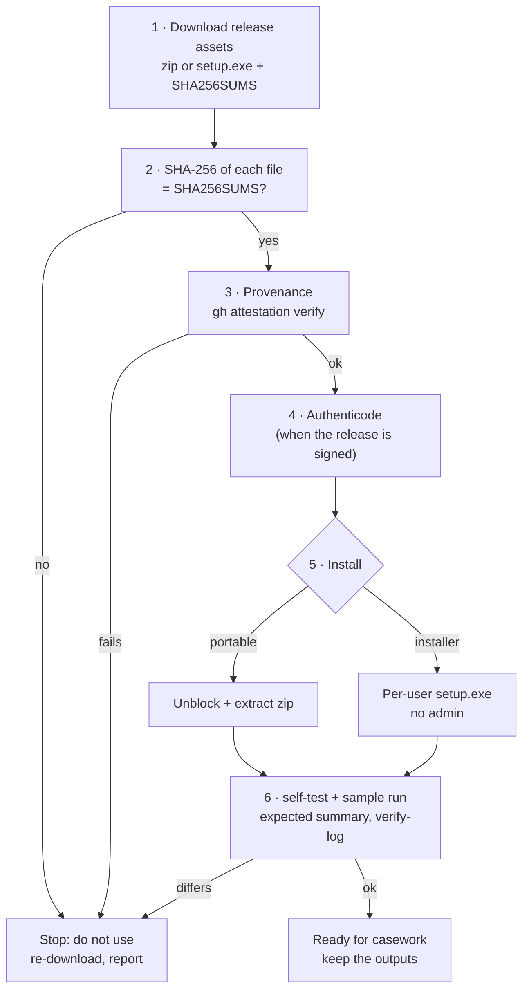

<!--
  Template note for the docs agent of a tool scaffolded from rv-hashinv: steps 1–5 and 7–11 are shared (release
  assets, verification, installer, runtime, offline use, build from source, uninstall). Rewrite the parts between
  forge:domain markers: extra native libraries the tool needs, and the expected result of the sample run.
-->

# Installation and verification (Windows 10/11)

RV HashInv runs **locally** on the examiner's Windows 10 or 11 PC (x64). The release is a self-contained folder
built with Nuitka: it includes its own Python runtime and Qt libraries, so nothing else is installed. It needs no
administrator rights and no network, except for the optional RFC 3161 timestamp. This page covers: getting a
release, **proving it is the genuine build**, installing it (portable zip or per-user installer), the first-run
self-test, offline use, building from source for auditors, where files live, and uninstalling.

Why verification matters: a court may ask how you know the program you ran is the one whose source an expert
reviewed. Steps 2–4 and 6 produce that answer; keep their output with the case file
([admissibility.md](admissibility.md#examiner-checklist-before-filing-a-report), step 3).



## Requirements

| Item | Requirement |
| --- | --- |
| Operating system | Windows 10 or 11, x64 (`MinVersion=10.0`, `ArchitecturesAllowed=x64compatible` in the installer). Linux/macOS: run from source. |
| Rights | Standard user. The installer is per-user (`PrivilegesRequired=lowest`). |
| Disk | The standalone folder (Python runtime, Qt libraries, both executables, docs: tens of MB); outputs need about 11 report files per item for one language (19 with `--lang all`) plus the logs. |
| Memory | Files are streamed in 1 MiB chunks: memory use does not grow with file size. |
| Network | None, except the optional timestamp request (see [step 7](#7-offline-and-air-gapped-use)). |

## 1. Download

Release assets on the GitHub Releases page of the repository (`rakvor/rv-hashinv`):

| Asset | What it is |
| --- | --- |
| `rv-hashinv-X.Y.Z-windows-x64.zip` | Portable standalone folder: `rv-hashinv.exe`, `rv-hashinv-gui.exe`, the Python runtime and packages compiled by Nuitka, the PySide6/Qt DLLs, README, LICENSE, NOTICE, CHANGELOG, `docs/`, `examples/` |
| `rv-hashinv-X.Y.Z-windows-x64-setup.exe` | Inno Setup installer, per-user (the same folder) |
| `SHA256SUMS` | SHA-256 of the zip, the installer and the SBOM (`sha256sum` format: `<hash>  ./<file>`) |
| `sbom.cdx.json` | CycloneDX software bill of materials generated from `uv.lock` (every Python package and version) |

Put them in one folder, e.g. `C:\Rakvor\downloads\rv-hashinv-0.1.0\`.

## 2. Verify the download

```powershell
cd C:\Rakvor\downloads\rv-hashinv-0.1.0
Get-Content .\SHA256SUMS | ForEach-Object {
    $hash, $name = $_ -split '\s+', 2
    $name = $name.TrimStart('*').Replace('./', '')
    if (Test-Path $name) {
        $actual = (Get-FileHash -Algorithm SHA256 $name).Hash.ToLower()
        if ($actual -eq $hash) { "OK    $name" } else { "FAIL  $name  (got $actual)" }
    } else { "skip  $name (not downloaded)" }
}
```

```bash
sha256sum -c --ignore-missing SHA256SUMS      # Linux, or Git Bash on Windows
```

Every downloaded file must print `OK`. `SHA256SUMS` is produced by the same workflow and is not attested itself:
step 3 is the stronger check.

## 3. Verify build provenance

Each zip and installer carries a GitHub build-provenance attestation (`actions/attest-build-provenance`): a signed
statement that this exact file was built by the repository's release workflow from a given commit. On a machine
with internet access and the GitHub CLI:

```powershell
gh attestation verify .\rv-hashinv-0.1.0-windows-x64.zip --repo rakvor/rv-hashinv
gh attestation verify .\rv-hashinv-0.1.0-windows-x64-setup.exe --repo rakvor/rv-hashinv
```

The output names the workflow (`.github/workflows/release.yml`) and the source commit; record both. For an
air-gapped lab, verify on a connected machine and carry the verified files on write-protected media (the GitHub CLI
can also download the attestation bundle and trusted root for offline checks; see `gh attestation verify --help`).
`SHA256SUMS` and the SBOM are not attested.

## 4. Verify the Authenticode signature (signed releases)

The release workflow signs `rv-hashinv.exe`, `rv-hashinv-gui.exe` and the installer **only when a code-signing
certificate is configured** for the repository (`SIGN_PFX_BASE64` secret; signtool with SHA-256 and an RFC 3161
timestamp). The Python runtime and Qt DLLs inside the folder are not re-signed by this workflow (some carry their
vendors' signatures). Check:

```powershell
Get-AuthenticodeSignature .\rv-hashinv-0.1.0-windows-x64-setup.exe |
    Format-List Status, StatusMessage, SignerCertificate, TimeStamperCertificate
# after extracting the zip:
Get-AuthenticodeSignature .\rv-hashinv.exe, .\rv-hashinv-gui.exe | Format-Table Status, Path
```

| Status | Meaning |
| --- | --- |
| `Valid` | Signed and intact; check that the signer is the expected Rakvor entity |
| `NotSigned` | The release was built without a signing certificate: rely on steps 2–3; Windows SmartScreen will warn |
| `HashMismatch` / other | Stop: the file was altered after signing |

With the Windows SDK, `signtool verify /pa /v rv-hashinv.exe` shows the full chain.

## 5. Install

### 5a. Portable zip

```powershell
# only after steps 2–4
Unblock-File .\rv-hashinv-0.1.0-windows-x64.zip
Expand-Archive .\rv-hashinv-0.1.0-windows-x64.zip -DestinationPath C:\Rakvor\tools\rv-hashinv-0.1.0
cd C:\Rakvor\tools\rv-hashinv-0.1.0
.\rv-hashinv.exe --version                  # rv-hashinv, version 0.1.0
```

Keep one folder per version so a past case can be re-run with the exact version recorded in its
`environment.json`. Optional, current session only: `$env:Path += ";C:\Rakvor\tools\rv-hashinv-0.1.0"`.

### 5b. Installer (per-user, no administrator)

Double-click `rv-hashinv-X.Y.Z-windows-x64-setup.exe` (English, Spanish or French wizard). It installs to
`%LOCALAPPDATA%\Programs\Rakvor\RV HashInv\`, creates a *Rakvor* Start-menu group (app + documentation), and offers
two tasks: **Add the rv-hashinv command to PATH** (user PATH, checked on first install) and a desktop icon. Open a
**new** terminal afterwards for PATH to apply.

Unattended:

```powershell
.\rv-hashinv-0.1.0-windows-x64-setup.exe /VERYSILENT /SUPPRESSMSGBOXES /NORESTART /TASKS="addtopath"
```

The installer copies the whole standalone folder of the release, including `docs\` and `examples\` (sample
evidence, scripts and `expected_hashes.csv`).

### 5c. Runtime and native libraries

The folder holds the Python runtime and packages compiled by Nuitka (standalone mode, not "onefile", so nothing is
unpacked to `%TEMP%` at start) and the **PySide6 / Qt** libraries as separate DLLs. Qt and PySide6 are LGPL-3.0:
they stay replaceable, which is why they are not linked into the executables. Their versions are in the SBOM and
in each run's `environment.json` (`PySide6-Essentials`, `shiboken6`). There is no separate file to download or
pin: the zip's SHA-256 (step 2) and attestation (step 3) cover every DLL in it.

<!-- forge:domain -->
This tool needs no further native library.
<!-- /forge:domain -->

## 6. First-run self-test and sample

```powershell
rv-hashinv --version
rv-hashinv self-test
```

`self-test` prints `PASS` for md5, sha1, sha256, sha512, sha3-256 and blake3 (known answers for `"abc"`), exit code
0. It tests the hash implementations only. Then run the synthetic sample, which exercises type detection,
duplicates, reports and the audit chain:

```powershell
# portable zip or installer (both include the script): self-test, sample scan, verify-log,
# then the tool's hashes.csv against expected_hashes.csv
.\examples\sample\run.ps1 -Bin .\rv-hashinv.exe

# or by hand into a temporary folder
$app = "$env:LOCALAPPDATA\Programs\Rakvor\RV HashInv"
$out = Join-Path $env:TEMP "rv-hashinv-check"
rv-hashinv scan -i "$app\examples\sample\evidence" --hash sha256,md5 --out $out --progress none --no-timestamp
$LASTEXITCODE                                  # 0
rv-hashinv verify-log (Get-ChildItem "$out\logs" | Select-Object -Last 1).FullName   # OK … chain intact
```

<!-- forge:domain -->
Expected summary: **3 items, 0 errors, findings high 0, medium 1, low 0, info 2**, exit code 0 (one
`EXTENSION_MISMATCH` for `foto-vacaciones.jpg`, one `DUPLICATE` pair `acta.txt` / `acta-copia.txt`). The SHA-256
column of `hashes.csv` must equal `examples\sample\expected_hashes.csv` (computed independently):

| File | Size | SHA-256 |
| --- | --: | --- |
| `acta-copia.txt` | 61 | `80e089ad6704c831e386b430adf92c5f5b72ec4428566d3580660e103c183c3c` |
| `acta.txt` | 61 | `80e089ad6704c831e386b430adf92c5f5b72ec4428566d3580660e103c183c3c` |
| `foto-vacaciones.jpg` | 112 | `42503ebb0f9892b30b72e11cfa0cbf5bcb5d60f667d611fa9598c9b4e835c643` |

`run.ps1` / `run.sh` make this comparison themselves: they read the tool's `logs\<RUN-ID>\hashes.csv` and compare
size, SHA-256 and MD5 of every file with `expected_hashes.csv`, print
`hashes.csv matches expected_hashes.csv (3 files: size, SHA-256, MD5)` and exit 3 on any difference. When running
by hand, compare the table above with `$out\logs\<RUN-ID>\hashes.csv`, or run
`python tests\verify_chain.py <log folder>` from the source tree, which re-hashes every file of `hashes.csv`.
<!-- /forge:domain -->

Keep the console output and the run folder as the record of this verification.

## 7. Offline and air-gapped use

The **only** network access in the code is the RFC 3161 timestamp request (one HTTP POST of a 32-byte hash to the
TSA, [src/rv_hashinv/core/trust.py](../src/rv_hashinv/core/trust.py)). There is no telemetry, update check or
licence check.

| To disable the timestamp | How |
| --- | --- |
| One CLI run | `--no-timestamp` |
| All CLI runs on this PC / session | `$env:RV_NO_TIMESTAMP = "1"` (or set it as a user environment variable) |
| GUI | untick **4. Trust → Trusted timestamp** before *Start review* |

An offline run with the timestamp enabled still completes: it logs `timestamp_pending` and the statistics report
shows a warning. Later, on a machine that can reach the TSA, run `rv-hashinv timestamp <log folder>` (it
re-verifies the chain, then appends `timestamp_obtained`). To use an internal or qualified TSA, pass `--tsa-url`
(see [admissibility.md](admissibility.md#53-eidas--regulation-eu-9102014-as-amended-by-eu-20241183)). The network
restriction is not enforced by the OS; on a connected workstation, a Windows Firewall outbound rule for
`rv-hashinv.exe` / `rv-hashinv-gui.exe` allowing only the TSA host enforces it.

## 8. Build from source for auditors

### Toolchain

| Item | Version |
| --- | --- |
| Python | `requires-python = ">=3.11"`; CI tests 3.11 and 3.13; releases are frozen with **3.13.14**, pinned as `RELEASE_PYTHON` in [release.yml](../.github/workflows/release.yml) and in the `freeze-smoke` job of [ci.yml](../.github/workflows/ci.yml) (a test checks both agree). To match a release, use the version recorded in that release's `environment.json` → `tool.python` (`uv python install 3.13.14`). |
| uv | [uv](https://docs.astral.sh/uv/) installs the interpreter and the dependencies from [uv.lock](../uv.lock) (every package pinned with its hashes). `--locked` refuses to run if the lock file would change. |
| Freezing (Windows) | Nuitka (dependency group `build`), a C compiler (Visual Studio 2022 Build Tools, or the MinGW64 that Nuitka offers to download — `--assume-yes-for-downloads` is set) |
| Linux | For the GUI tests: Qt runtime libraries (`libegl1 libxkbcommon0 libgl1 libfontconfig1 libdbus-1-3`) |

### Run and test from source

```powershell
git clone https://github.com/rakvor/rv-hashinv.git
cd rv-hashinv
git checkout v0.1.0                       # the tag of the release under review
uv sync --locked --extra gui              # .venv from uv.lock
uv run rv-hashinv self-test
uv run rv-hashinv scan -i examples\sample\evidence --hash sha256,md5 --out $env:TEMP\check --progress none --no-timestamp
uv run pytest                             # core, CLI, case folder, trust (local test TSA), GUI state, GUI window (offscreen)
```

```bash
# Linux
uv sync --locked --extra gui
uv run rv-hashinv self-test
uv run rv-hashinv scan -i examples/sample/evidence --hash sha256,md5 --out /tmp/check --progress none --no-timestamp
uv run python tests/verify_chain.py /tmp/check/logs/$(ls /tmp/check/logs | tail -n 1)
# cross-profile: a case folder written by the Rust profile must verify with this build
uv run python tests/golden/unpack.py tests/golden/case-by-rust.zip.b64 /tmp/golden
uv run rv-hashinv verify-case /tmp/golden/CASE-GOLDEN
```

### Freeze the Windows build

```powershell
uv sync --locked --extra gui --group build
uv run python packaging/build_windows.py           # dist\rv-hashinv\ : both executables + runtime + Qt DLLs
.\dist\rv-hashinv\rv-hashinv.exe self-test
.\examples\sample\run.ps1 -Bin .\dist\rv-hashinv\rv-hashinv.exe
```

[packaging/build_windows.py](../packaging/build_windows.py) compiles the two entry points
([packaging/entry/](../packaging/entry/rv_hashinv_cli.py)) with Nuitka `--standalone`, the PySide6 plugin for the GUI,
the Rakvor icon and version resources, then merges both builds into one folder (shared runtime) and copies README,
LICENSE, NOTICE and CHANGELOG. The release workflow adds `docs\` and `examples\`.

### Reproducing the release hashes

Be precise about what can and cannot match bit for bit in this version (gap G22):

| Artefact | Bit-identical to the release? | How to check |
| --- | --- | --- |
| `docs/`, `examples/` files | Yes (from git; LF line endings except `*.ps1`, `*.iss`) | `git ls-files` + `Get-FileHash` against the extracted zip |
| Python packages in `.venv` | Same versions and wheel hashes as `uv.lock` | `uv sync --locked`; compare with `sbom.cdx.json` |
| `rv-hashinv.exe`, `rv-hashinv-gui.exe`, compiled modules | **Not guaranteed**: Nuitka compiles to C and links with the runner's compiler (the Python patch version is pinned: `RELEASE_PYTHON`) | Provenance attestation (step 3) binds the released files to the workflow and commit; then compare behaviour (below) |
| zip, installer | No (archive timestamps) | Attestation (step 3) |

**Functional equivalence** — run the sample with the release binary and with your build (frozen or `uv run`), then
compare the digests and findings of every item:

```bash
python - "<release-out>/reports/<RUN-ID>" "<your-out>/reports/<RUN-ID>" <<'EOF'
import glob, json, sys
def load(run):
    out = {}
    for p in sorted(glob.glob(f"{run}/items/*/technical.json")):
        t = json.load(open(p, encoding="utf-8"))
        out[t["item"]["file_name"]] = (t["hashes"], t["item"]["detected_type"],
                                       [(f["code"], f["severity"], f["params"]) for f in t["findings"]])
    return out
a, b = load(sys.argv[1]), load(sys.argv[2])
print("identical findings and digests" if a == b else "DIFFERENT: " + ", ".join(k for k in a if a.get(k) != b.get(k)))
EOF
```

The same script compares this build with the Rust profile of the tool (measured identical on the sample).

## 9. Where things live

| What | Location |
| --- | --- |
| Program (installer) | `%LOCALAPPDATA%\Programs\Rakvor\RV HashInv\` (both executables, runtime, Qt DLLs, `docs\`, `examples\`, `unins000.exe`) |
| Program (portable) | the folder you extracted |
| Program (from source) | the repository's `.venv\` (created by `uv sync`) |
| PATH entry (installer task) | user environment variable `Path` (`HKCU\Environment`) |
| Run outputs | `--out` (default `.\rakvor-out` **relative to the current folder**): `logs\<RUN-ID>\`, `reports\<RUN-ID>\`. With `--case-dir`: `<CASE>\runs\rv-hashinv\<RUN-ID>\`. The GUI uses its *Output folder* field (or the case folder) |
| Case folder | wherever you create it with `--case-dir` (`case.json`, `case-log.jsonl`, `evidence\`, `runs\`) |
| GUI settings | not persisted: each start uses the defaults; every change made before a run is recorded in that run's audit log (`ui_*`) |
| Signing certificate | wherever you keep it; only its path, subject and SHA-256 fingerprint are logged, never the password |
| Local data, caches, temporary files | none for the frozen build (no `.pyc` files, nothing unpacked to `%TEMP%`); from source, Python writes `__pycache__` folders in the repository |

## 10. Uninstall

- **Installer:** *Settings → Apps → Installed apps → RV HashInv → Uninstall*, or run
  `"%LOCALAPPDATA%\Programs\Rakvor\RV HashInv\unins000.exe"`. It removes the installed files and shortcuts. The user
  **PATH entry is not removed** in this version; remove it with:

  ```powershell
  $dir = "$env:LOCALAPPDATA\Programs\Rakvor\RV HashInv"
  $p = [Environment]::GetEnvironmentVariable("Path", "User").Split(";") | Where-Object { $_ -and $_ -ne $dir }
  [Environment]::SetEnvironmentVariable("Path", ($p -join ";"), "User")
  ```

- **Portable:** delete the folder. **From source:** delete the repository (or its `.venv\`).
- **Kept on purpose** (all cases): run outputs and case folders (case material). Keep the release zip and
  `SHA256SUMS` of every version used in a case, so it can be re-run.

## 11. Installation troubleshooting

| Symptom | Cause and fix |
| --- | --- |
| SmartScreen "Windows protected your PC" | Unsigned release (step 4 `NotSigned`). Only after steps 2–3 pass: *More info → Run anyway*. |
| Antivirus quarantines a file of the folder | Compiled Python programs are sometimes flagged. Restore it only after steps 2–3 pass; ask IT for an exclusion of the versioned folder. A missing DLL breaks the GUI or the CLI at start. |
| `rv-hashinv` is not recognised | PATH task not selected, or the terminal was opened before installing: open a new terminal or use the full path. |
| `self-test` prints `FAIL` | Do not use this build for evidence; re-download and repeat steps 2–4. |
| Sample summary differs from step 6 | Wrong version or modified sample files; compare `environment.json` with the release notes and the sample digests with `expected_hashes.csv`. |
| GUI does not start from source on Linux ("could not load the Qt platform plugin") | Install the Qt runtime libraries listed in step 8, or set `QT_QPA_PLATFORM=offscreen` for tests. |
| `uv sync --locked` fails | The lock file does not match `pyproject.toml` at that commit; check out the exact release tag. |
