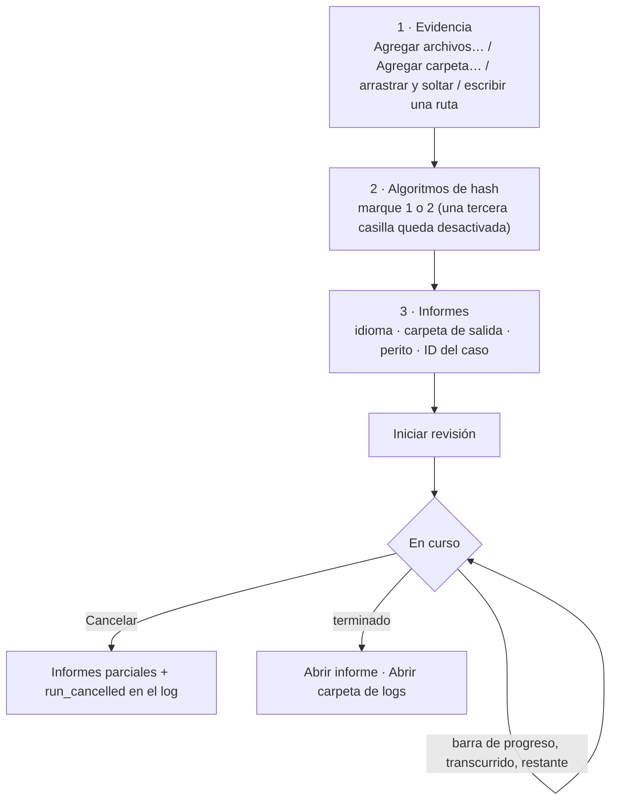

> La versión de referencia es la inglesa ([usage-gui.md](usage-gui.md)); esta traducción la sigue.

# Uso de la aplicación de escritorio (Windows 10/11)

Inicie **RV HashInv** desde el menú Inicio (instalador) o haga doble clic en `rv-hashinv-gui.exe` (zip portable).
No hace falta instalar ningún otro programa; la aplicación también funciona en máquinas virtuales sin controlador
gráfico (renderizado por software).

## Flujo de trabajo

## Revisar evidencia en 6 pasos

1. **Agregue la evidencia.** *Agregar archivos…* o *Agregar carpeta…*, arrastre archivos a la ventana, o escriba
   una ruta y pulse *Agregar ruta*. Quite una entrada con **x**. Todavía no se escribe nada: cada cambio se guarda
   como `ui_input_added` / `ui_input_removed` y pasa al log de auditoría cuando empieza la ejecución.
2. **Elija los algoritmos de hash.** Marque uno o dos (conserve `sha256`). Se guarda como `ui_hash_selection_changed`.
3. **Configure los informes.** *Idioma de los informes*, *Carpeta de salida* (o una **Carpeta del caso**, ver más
   abajo), *Perito* e *ID del caso*. Se guardan como `ui_language_changed` y `ui_case_dir_changed`; el perito y el
   ID del caso se registran en `ui_start_clicked` y se imprimen en cada informe y formato de custodia.
4. **Configure las opciones de confianza.** *Formato de custodia* (Colombia / Francia), *Sello de tiempo confiable*
   y la dirección de su TSA, *Certificado de firma (.p12/.pfx)* y *Contraseña del certificado*. Se guardan como
   `ui_jurisdiction_changed`, `ui_timestamp_changed` y `ui_signing_certificate_changed` (solo la ruta; la
   contraseña nunca se registra).
5. **Pulse *Iniciar revisión*.** La ejecución escribe `<OUT>/logs/<RUN-ID>/` (log de auditoría, registro de hashes,
   entorno, token del sello de tiempo) y `<OUT>/reports/<RUN-ID>/` (estadísticas y una carpeta por elemento con la
   revisión técnica, el resumen y el formato de custodia). *Cancelar* se detiene tras el archivo en curso y escribe
   informes parciales.
6. **Abra los resultados.** **Abrir informe** abre la página de estadísticas en el idioma de los informes (en inglés
   si se eligieron los tres); **Abrir carpeta de logs** abre `<OUT>/logs/<RUN-ID>/`. Lea los conteos por severidad
   y las **Advertencias** antes de apoyarse en la ejecución.

## La ventana

| Zona | Qué hace |
| --- | --- |
| **1. Evidencia** | *Agregar archivos…* y *Agregar carpeta…* abren los selectores de Windows. También puede arrastrar archivos o carpetas a la ventana (o al icono de `rv-hashinv-gui.exe` antes de que arranque), o pegar una ruta y pulsar Enter. *Incluir subcarpetas* está activada por defecto. Quite una entrada con **x**. |
| **2. Algoritmos de hash** | Marque uno o dos. Con dos marcados, los demás se desactivan; no se puede desmarcar el último. |
| **3. Informes** | Idioma (English, Español, Français o los tres), carpeta de salida, nombre del perito (por defecto su usuario de Windows), ID del caso opcional. |
| **4. Confianza** | *Formato de custodia*: Colombia (Fiscalía) o Francia (scellé), para el formato de custodia. *Sello de tiempo confiable* (activado por defecto; la dirección de la TSA se puede editar). El sello de tiempo solo es cualificado según eIDAS si la dirección de la TSA es la de un prestador cualificado de servicios de confianza (QTSP) inscrito en una lista de confianza de la UE; la dirección por defecto (DigiCert) no lo es. *Certificado de firma (.p12/.pfx)* (escriba una ruta o pulse *Examinar…*) y *Contraseña del certificado* (solo en memoria, nunca se registra) para firmar cada PDF. |
| **Idioma de la interfaz** | Selector arriba a la derecha: English, Español, Français. Cambia todas las etiquetas de inmediato; es independiente del idioma de los informes. |
| **Iniciar revisión / Cancelar** | Iniciar se habilita en cuanto se agrega evidencia. Durante una ejecución los ajustes quedan bloqueados y el botón pasa a ser *Cancelar*. |
| **Progreso** | Barra por bytes procesados, `archivos hechos / total`, tiempo transcurrido (siempre en movimiento) y tiempo restante estimado. Debajo se muestra el archivo que se está leyendo. |
| **Resultado** | Conteos por severidad, **Abrir informe** (página de estadísticas en su idioma) y **Abrir carpeta de logs**. |
| **Aviso de versión** | Al arrancar, la aplicación comprueba una vez, en segundo plano, si hay una versión más nueva publicada (un único GET HTTPS de la página pública de versiones de GitHub, solo con `User-Agent: rv-hashinv/<version>`). Si la hay, un aviso la nombra con un enlace a su página; no se descarga ni se instala nada, y la comprobación no se escribe en ningún log de auditoría. Se desactiva con `RV_NO_UPDATE_CHECK=1` o con el archivo `update-check-off` en `%APPDATA%\Rakvor` ([installation.es.md](installation.es.md#verificación-de-versiones)). |

## Carpeta del caso

Complete **Carpeta del caso** en la sección 1 para trabajar dentro de una carpeta compartida del caso (ver
[case-folder.md](case-folder.md), en inglés). Para una carpeta nueva, complete también **ID del caso** (y el
**Formato de custodia**): se escriben una sola vez en `case.json`. Mientras haya una carpeta del caso,
la **Carpeta de salida** muestra `<case>/runs/rv-hashinv/<RUN-ID>` y no se puede editar, y puede iniciar sin agregar
evidencia (se examina cada elemento registrado). Tras la ejecución, el panel de resultado lista el **ID de evidencia**
de cada elemento (E0001…) y su estado (registrado, verificado, no coincide, no está en el registro). El cambio se
audita como `ui_case_dir_changed`.

RV Hub abre la aplicación con la carpeta del caso ya completada: `rv-hashinv-gui.exe --case-dir <CASE> [FILES...]` (o
`--case-dir=<CASE>`). El log de auditoría empieza entonces con `ui_case_dir_from_launcher` (la ruta y `at_utc`); un
`--case-dir` sin carpeta se ignora, se indica en la ventana y se registra como `ui_launch_argument_ignored`.

## Lo que registra la GUI

Sus elecciones forman parte del registro de la evidencia. Antes de que empiece la ejecución, la GUI las escribe en el
log de auditoría:

| Acción | Registrada como |
| --- | --- |
| Agregar / quitar evidencia | `ui_input_added`, `ui_input_removed` |
| Cambiar la selección de hash | `ui_hash_selection_changed` |
| Cambiar el idioma de los informes / subcarpetas | `ui_language_changed`, `ui_recursive_changed` |
| Cambiar el idioma de la interfaz | `ui_interface_language_changed` |
| Cambiar el formato de custodia | `ui_jurisdiction_changed` |
| Cambiar el sello de tiempo confiable (activado/desactivado, dirección de la TSA) | `ui_timestamp_changed` |
| Cambiar el certificado de firma (la ruta; nunca la contraseña) | `ui_signing_certificate_changed` |
| Abierta por RV Hub con `--case-dir` | `ui_case_dir_from_launcher`, `ui_case_dir_changed` (o `ui_launch_argument_ignored`) |
| Pulsar Iniciar | `ui_start_clicked` (ajustes finales) |
| Pulsar Cancelar | `item_cancelled`, `run_cancelled` |

Los errores durante la ejecución aparecen en **Advertencias** y en el log como `item_error`.
Los mensajes de validación mostrados *antes* de una ejecución (p. ej. "Add at least one file or folder") no se
registran, porque todavía no existe ninguna ejecución y, por tanto, ningún log.

## Mismos resultados que la línea de comandos

La GUI llama al mismo motor que `rv-hashinv scan`. Una ejecución en la GUI con la misma evidencia, los mismos
algoritmos y el mismo idioma da hashes y hallazgos idénticos; `environment.json` registra `"frontend": "gui"` y los
ajustes usados.
