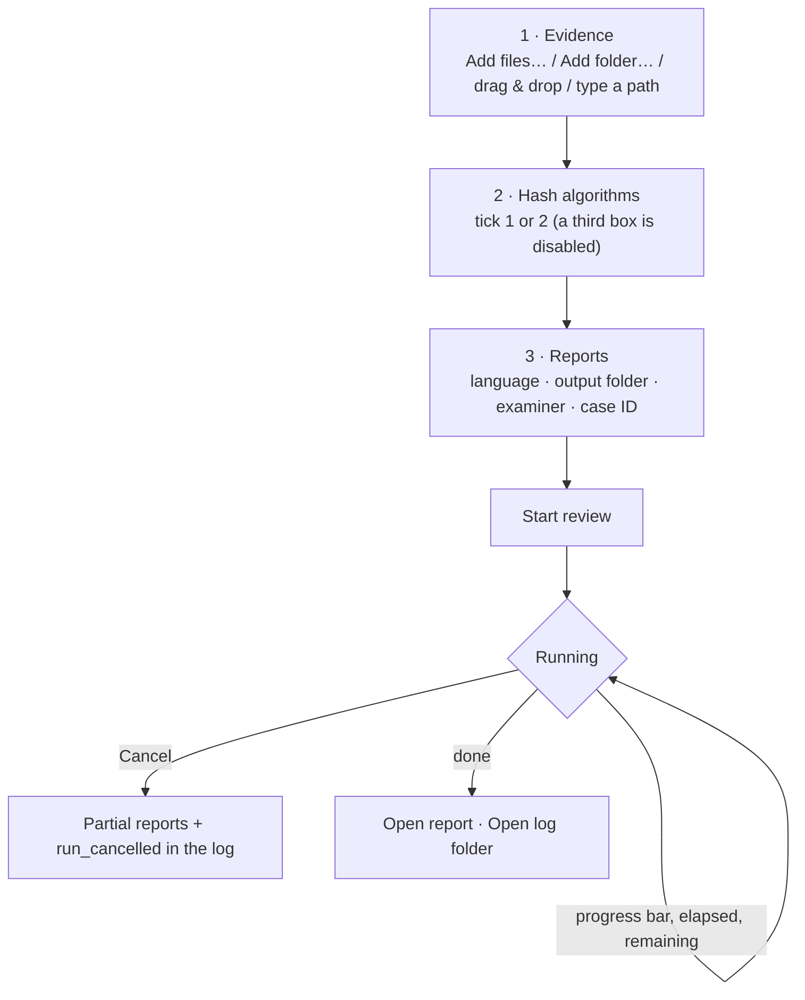

# Using the desktop app (Windows 10/11)

Start **RV HashInv** from the Start menu (installer) or double-click `rv-hashinv-gui.exe` (portable zip).
No installation of other software is required; the app also runs on virtual machines without a graphics
driver (software rendering).

## Workflow

## Review evidence in 6 steps

1. **Add the evidence.** *Add files…* or *Add folder…*, drag files onto the window, or type a path and press
   *Add path*. Remove an entry with **x**. Nothing is written yet: each change is kept as `ui_input_added` /
   `ui_input_removed` and goes into the audit log when the run starts.
2. **Pick the hash algorithms.** Tick one or two (keep `sha256`). Kept as `ui_hash_selection_changed`.
3. **Set the reports.** *Report language*, *Output folder* (or a **Case folder**, see below), *Examiner* and
   *Case ID*. Kept as `ui_language_changed` and `ui_case_dir_changed`; the examiner is recorded as the `actor` of
   every audit entry and the case ID in `run_started`; both are printed on every report and custody form.
4. **Set the trust options.** *Custody form* (Colombia / France), *Trusted timestamp* and its TSA address,
   *Signing certificate (.p12/.pfx)* and *Certificate password*. Kept as `ui_jurisdiction_changed`,
   `ui_timestamp_changed` and `ui_signing_certificate_changed` (the path only; the password is never logged).
5. **Press *Start review*.** The run writes `<OUT>/logs/<RUN-ID>/` (audit log, hash register, environment,
   timestamp token) and `<OUT>/reports/<RUN-ID>/` (statistics and one folder per item with the technical
   review, the summary and the custody form). *Cancel* stops after the current file and writes partial reports.
6. **Open the results.** **Open report** opens the statistics page in the report language (English when all
   three are chosen); **Open log folder** opens `<OUT>/logs/<RUN-ID>/`. Read the counts by severity and the
   **Warnings** before relying on the run.

## The window

| Area | What it does |
| --- | --- |
| **1. Evidence** | *Add files…* and *Add folder…* open the Windows pickers. You can also drag files or folders onto the window (or onto the `rv-hashinv-gui.exe` icon before it starts), or paste a path and press Enter. *Include subfolders* is on by default. Remove an entry with **x**. |
| **2. Hash algorithms** | Tick one or two. When two are ticked, the others are disabled; you cannot untick the last one. |
| **3. Reports** | Language (English, Español, Français, or all three), output folder, examiner name (defaults to your Windows user), optional case ID. |
| **4. Trust** | *Custody form*: Colombia (Fiscalía) or France (scellé), for the custody form. *Trusted timestamp* (on by default; TSA address editable). The timestamp is eIDAS-qualified only if the TSA address is that of a qualified trust service provider (QTSP) on an EU trusted list; the default address (DigiCert) is not one (to be verified). *Signing certificate (.p12/.pfx)* (type a path or *Browse…*) and *Certificate password* (kept in memory only, never logged) so every PDF is signed. |
| **Interface language** | Top-right selector: English, Español, Français. Changes every label immediately; independent of the report language. |
| **Start review / Cancel** | Start is enabled once evidence is added. During a run the settings are locked and the button becomes *Cancel*. |
| **Progress** | Bar by bytes processed, `files done / total`, elapsed time (always moving) and estimated time remaining. The file being read is shown below. |
| **Result** | Counts by severity, **Open report** (statistics page in your language) and **Open log folder**. |
| **Release notice** | At start-up the app checks once, in the background, whether a newer release is published (one HTTPS GET of the public GitHub release page, with `User-Agent: rv-hashinv/<version>` only). If there is one, a banner names it with a link to its release page; nothing is downloaded or installed, and the check is not written to any audit log. Turn it off with `RV_NO_UPDATE_CHECK=1` or the file `update-check-off` in `%APPDATA%\Rakvor` ([installation.md](installation.md#release-check)). |

## Case folder

Fill **Case folder** in section 1 to work inside a shared case folder (see [case-folder.md](case-folder.md)).
For a new folder, also fill **Case ID** (and the **Custody form**): they are written once to
`case.json`. While a case folder is set, the **Output folder** shows `<case>/runs/rv-hashinv/<RUN-ID>` and cannot
be edited, and you may start without adding evidence (every registered item is examined). After the run, the
result panel lists the **evidence id** of every item (E0001…) and its status (registered, verified, mismatch, not in
registry). The change is audited as `ui_case_dir_changed`.

RV Hub opens the app with the case folder already filled: `rv-hashinv-gui.exe --case-dir <CASE> [FILES...]` (or
`--case-dir=<CASE>`). The audit log then starts with `ui_case_dir_from_launcher` (the path and `at_utc`); a
`--case-dir` without a folder is ignored, shown in the window and logged as `ui_launch_argument_ignored`.

## What the GUI records

Your choices are part of the evidence record. Before the run starts, the GUI writes them to the audit log:

| Action | Logged as |
| --- | --- |
| Add / remove evidence | `ui_input_added`, `ui_input_removed` |
| Change hash selection | `ui_hash_selection_changed` |
| Change report language / subfolders | `ui_language_changed`, `ui_recursive_changed` |
| Change interface language | `ui_interface_language_changed` |
| Change custody form | `ui_jurisdiction_changed` |
| Change trusted timestamp (on/off, TSA address) | `ui_timestamp_changed` |
| Change signing certificate (path; never the password) | `ui_signing_certificate_changed` |
| Opened by RV Hub with `--case-dir` | `ui_case_dir_from_launcher`, `ui_case_dir_changed` (or `ui_launch_argument_ignored`) |
| Press Start | `ui_start_clicked` (final settings) |
| Press Cancel | `item_cancelled`, `run_cancelled` |

Errors during the run appear under **Warnings** and in the log as `item_error`.
Validation messages shown *before* a run (e.g. "Add at least one file or folder") are not logged, because no run — and
therefore no log — exists yet.

## Same results as the command line

The GUI calls the same engine as `rv-hashinv scan`. A GUI run with the same evidence, algorithms and language gives
identical hashes and findings; `environment.json` records `"frontend": "gui"` and the settings used.
